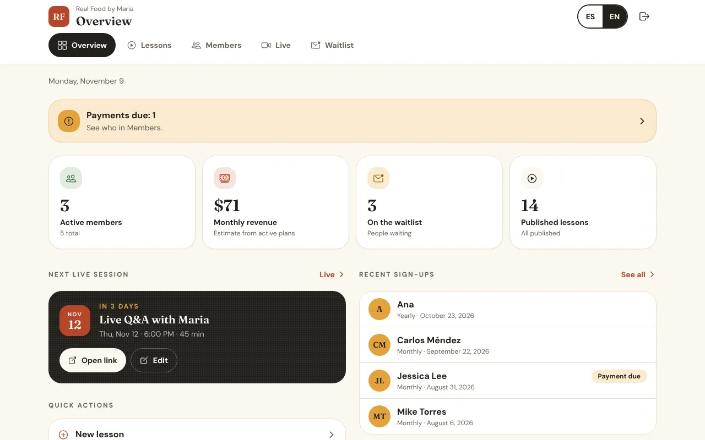
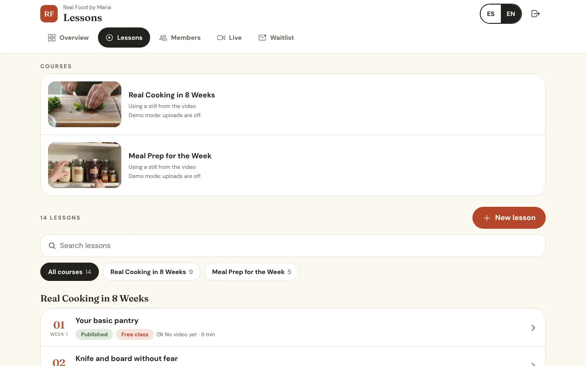
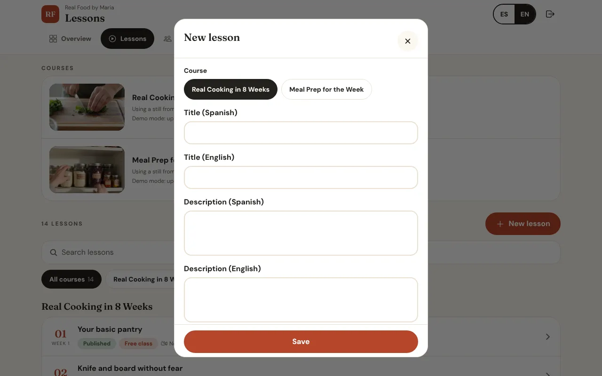
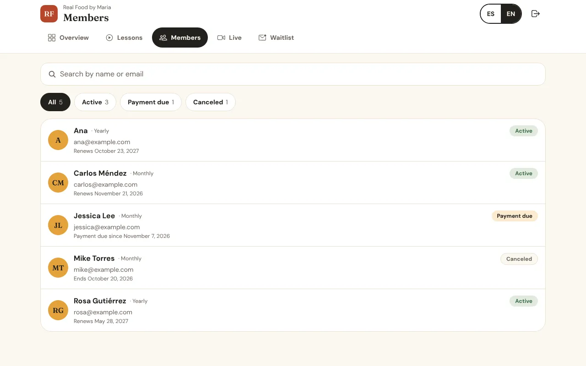
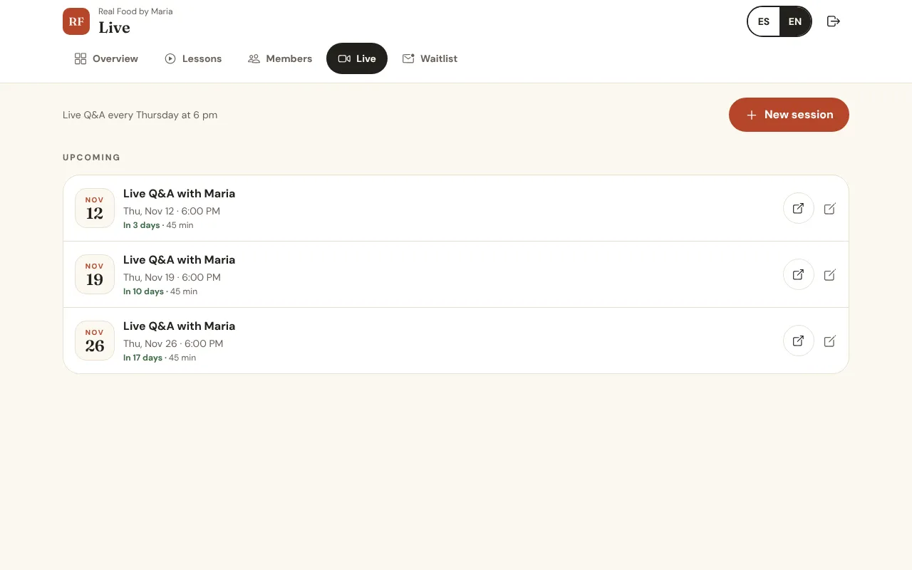
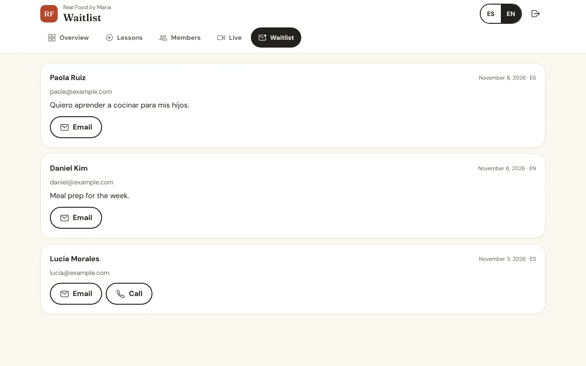

<!-- lang:en -->
# Your dashboard: what you can do, and what we can add later

*Real Food by Maria · Updated November 9, 2026*

The dashboard is the private part of the platform that only you can open. It's where you add lessons, schedule live classes and see your members, without calling a developer. It works on the website and inside the app on your phone.

## How to use this guide

| Tab | What it's for |
| --- | --- |
| Overview | Your numbers today, anything that needs attention, the next live class |
| Lessons | Add, edit and publish lessons; upload videos, files and course covers |
| Members | See who's a member, their plan and payment status |
| Live | Schedule live classes with a Zoom or Meet link |
| Waitlist | People who asked to hear from you |

> You don't need to know anything technical. Every screen has the same few buttons: **Add**, **Edit**, **Save**.

---

## Step 1 — Overview

**What you can do**

- See active members, new members this month, estimated monthly income, waitlist and published lessons at a glance.
- Get a yellow alert when a member's payment failed, with one tap to see who.
- See your next live class, open its link, or edit it.
- Use shortcuts to add a lesson or a live class.
- See your latest sign-ups.

## Step 2 — Lessons

**What you can do**

- See every lesson by course, with a search box.
- See at a glance which lessons are **Published** or **Draft**, and which still need a video.
- Change each course's cover photo by uploading one from your computer or phone.
- Delete a lesson (it asks you to confirm first).

**Adding or editing a lesson**

1. Tap **Add lesson**, or tap an existing one.
2. Choose the course and the week it unlocks.
3. Write the title and short description in English and Spanish.
4. Upload the video. It goes straight to private storage, no YouTube or Vimeo needed.
5. Add downloads (recipe card, shopping list, PDF) with a name for each.
6. Mark it as a **Free class** if anyone should be able to watch it.
7. Switch **Published** on when it's ready, then **Save**. Leave it off to keep it as a draft.

## Step 3 — Members

**What you can do**

- Search members by name or email.
- Filter by **Active**, **Past due** (payment failed) or **Canceled**, with a count on each.
- See each member's plan and the date they renew, ended or became past due.

> Memberships change only through payments, never by hand, so the list is always right. Refunds and cancellations you want to make yourself are done in your Stripe dashboard.

## Step 4 — Live classes

**What you can do**

1. Tap **Add live class**.
2. Write the title in English and Spanish, and set the date, time and length.
3. Paste your Zoom or Google Meet link, then **Save**.

Members see it on their Live page right away and get an email reminder on the day. Past classes move to their own list.

## Step 5 — Waitlist

**What you can do**

- See everyone who left their name and email (for example, before a new course opens).
- Email or call them with one tap.
- In the app on your phone, you can turn on alerts so you're notified when someone signs up.

---

## What we can add later

These aren't part of the first build. Any of them can be added when you need it, and each one is quoted at that time. Some are included in the Standard and Priority care plans as your yearly major update (see **Price breakdown & care plans**).

| Add-on | What it would do |
| --- | --- |
| Community | A members-only space to post photos of what they cooked, comment and ask questions |
| Quizzes and challenges | Short quizzes or 30-day challenges with check-ins |
| Certificates | A certificate when someone finishes a course |
| Recipe and meal-plan store | Sell single recipe packs, ebooks or meal plans without a membership |
| One-time courses | Courses people buy once and keep, next to the membership |
| Gift memberships | Someone buys a membership for a friend or family member |
| Discount codes | Codes for launches, holidays or partners |
| 1-on-1 coaching bookings | Members book and pay for private sessions on your calendar |
| Email newsletters | Send updates to members and the waitlist from the dashboard |
| Member progress reports | See which lessons get watched most and where people stop |
| More languages | Add a third language beyond English and Spanish |

<!-- lang:es -->
# Tu panel: lo que puedes hacer y lo que podemos agregar después

*Real Food by Maria · Actualizado el 9 de noviembre de 2026*

El panel es la parte privada de la plataforma que solo tú puedes abrir. Ahí agregas lecciones, programas clases en vivo y ves a tus miembros, sin llamar a un programador. Funciona en el sitio web y dentro de la app en tu teléfono.

## Cómo usar esta guía

| Pestaña | Para qué sirve |
| --- | --- |
| Resumen | Tus números de hoy, lo que necesita atención, la próxima clase en vivo |
| Lecciones | Agregar, editar y publicar lecciones; subir videos, archivos y portadas |
| Miembros | Ver quién es miembro, su plan y el estado de su pago |
| En vivo | Programar clases en vivo con un enlace de Zoom o Meet |
| Lista de espera | Personas que pidieron saber de ti |

> No necesitas saber nada técnico. Cada pantalla tiene los mismos botones: **Agregar**, **Editar**, **Guardar**.

---

## Paso 1 — Resumen

**Lo que puedes hacer**

- Ver miembros activos, nuevos miembros del mes, ingreso mensual estimado, lista de espera y lecciones publicadas de un vistazo.
- Recibir un aviso amarillo cuando falla el pago de un miembro, con un toque para ver quién.
- Ver tu próxima clase en vivo, abrir su enlace o editarla.
- Usar atajos para agregar una lección o una clase en vivo.
- Ver tus inscripciones más recientes.

## Paso 2 — Lecciones

**Lo que puedes hacer**

- Ver todas las lecciones por curso, con buscador.
- Ver de un vistazo cuáles están **Publicadas** o en **Borrador**, y cuáles aún necesitan video.
- Cambiar la foto de portada de cada curso subiéndola desde tu computadora o teléfono.
- Borrar una lección (te pide confirmar primero).

**Agregar o editar una lección**

1. Toca **Agregar lección**, o toca una existente.
2. Elige el curso y la semana en que se desbloquea.
3. Escribe el título y una descripción corta en inglés y español.
4. Sube el video. Va directo a almacenamiento privado, sin YouTube ni Vimeo.
5. Agrega descargas (tarjeta de receta, lista del súper, PDF) con un nombre para cada una.
6. Márcala como **Clase gratis** si cualquiera debe poder verla.
7. Activa **Publicada** cuando esté lista y toca **Guardar**. Déjala apagada para guardarla como borrador.

## Paso 3 — Miembros

**Lo que puedes hacer**

- Buscar miembros por nombre o correo.
- Filtrar por **Activos**, **Pago vencido** (falló el pago) o **Cancelados**, con el número de cada uno.
- Ver el plan de cada miembro y la fecha en que renueva, terminó o se venció su pago.

> Las membresías solo cambian con los pagos, nunca a mano, así que la lista siempre está correcta. Los reembolsos y cancelaciones que quieras hacer tú se hacen en tu panel de Stripe.

## Paso 4 — Clases en vivo

**Lo que puedes hacer**

1. Toca **Agregar clase en vivo**.
2. Escribe el título en inglés y español, y elige fecha, hora y duración.
3. Pega tu enlace de Zoom o Google Meet y toca **Guardar**.

Los miembros la ven de inmediato en su página En vivo y reciben un correo recordatorio ese día. Las clases pasadas se mueven a su propia lista.

## Paso 5 — Lista de espera

**Lo que puedes hacer**

- Ver a todos los que dejaron su nombre y correo (por ejemplo, antes de abrir un curso nuevo).
- Escribirles o llamarles con un toque.
- En la app de tu teléfono puedes activar avisos para saber cuando alguien se apunta.

---

## Lo que podemos agregar después

Esto no es parte de la primera versión. Cualquiera se puede agregar cuando lo necesites, y cada uno se cotiza en ese momento. Algunos entran en los planes de mantenimiento Standard y Priority como tu actualización grande del año (ver **Desglose de precio y planes de mantenimiento**).

| Extra | Qué haría |
| --- | --- |
| Comunidad | Un espacio solo para miembros para subir fotos de lo que cocinaron, comentar y preguntar |
| Quizzes y retos | Quizzes cortos o retos de 30 días con seguimiento |
| Certificados | Un certificado cuando alguien termina un curso |
| Tienda de recetas y planes | Vender paquetes de recetas, ebooks o planes de comida sin membresía |
| Cursos de pago único | Cursos que se compran una vez y se quedan, junto a la membresía |
| Membresías de regalo | Alguien compra una membresía para un amigo o familiar |
| Códigos de descuento | Códigos para lanzamientos, fechas especiales o socios |
| Reservas de coaching 1 a 1 | Los miembros reservan y pagan sesiones privadas en tu calendario |
| Boletines por correo | Enviar novedades a miembros y lista de espera desde el panel |
| Reportes de progreso | Ver qué lecciones se ven más y dónde la gente se detiene |
| Más idiomas | Agregar un tercer idioma además de inglés y español |
