<!-- lang:en -->
# Your platform, page by page

*Real Food by Maria · Updated November 9, 2026*

This guide walks through every page of the platform: what it shows, and what your visitors and members can do on it. The screenshots come from the demo at courses--maria.expo.app. Colors, photos and words will change once we build it with your real content.

## How to use this guide

| Part | Who sees it | Pages |
| --- | --- | --- |
| Public pages | Anyone, before paying | Home, Courses, Course page, Free class, Join, Link page |
| Members area | Paying members, after signing in | Member home, Lessons, Lesson, Live classes, Account |
| Your dashboard | Only you | See the guide **Your dashboard** |

> The same platform runs as a website and as iPhone and Android apps. Members sign in once and their progress follows them on every device.

---

## Step 1 — Home page

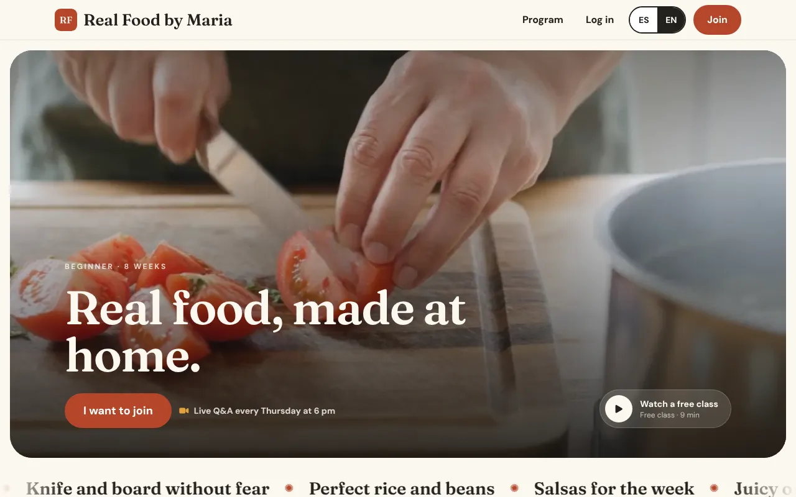

The first page people see from Instagram, Google or a shared link.

- **What it shows:** your photo or video, your name, one sentence about what you teach, and a button to join.
- **What visitors can do:** read about the program, see what a week looks like, compare plans, and read the questions people usually ask.
- **Language:** a switch at the top changes everything between English and Spanish. The site remembers the choice.

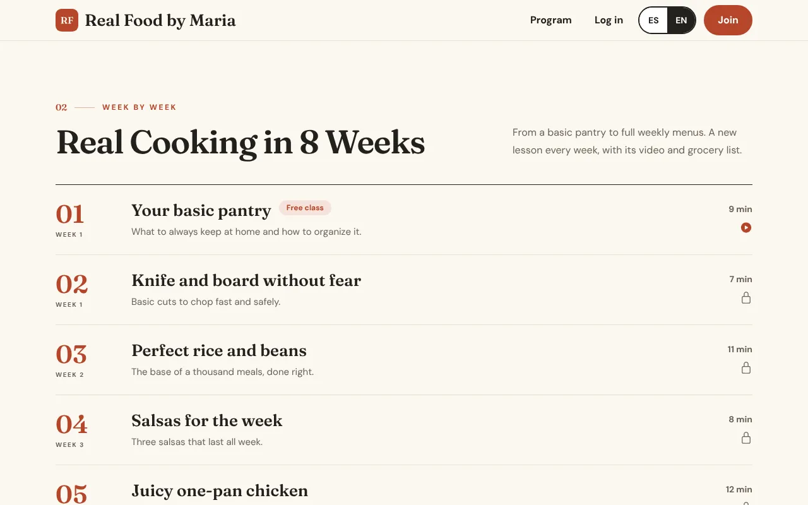

**The program section** explains how it works: new lessons each week, recipes to download, and live classes to ask questions.

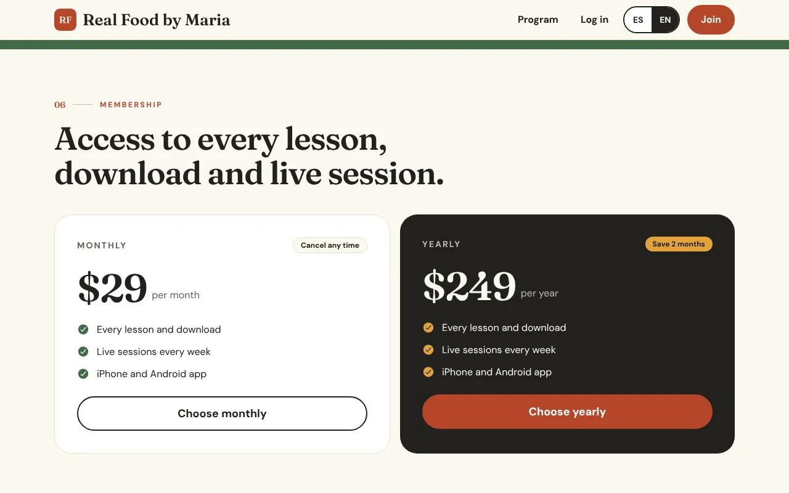

**The plans section** shows each membership with its price and what it includes, so people can choose before signing up.

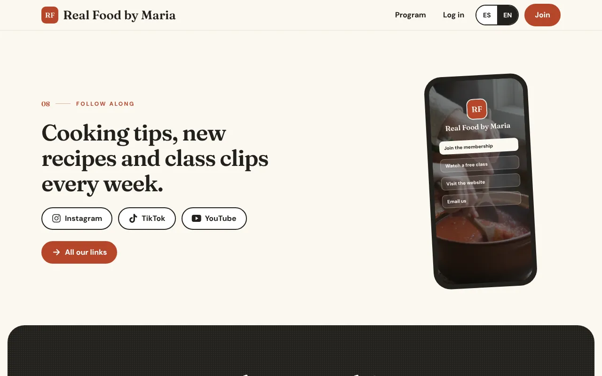

**Follow along** links to your Instagram, TikTok, YouTube and Facebook, and to your link page.

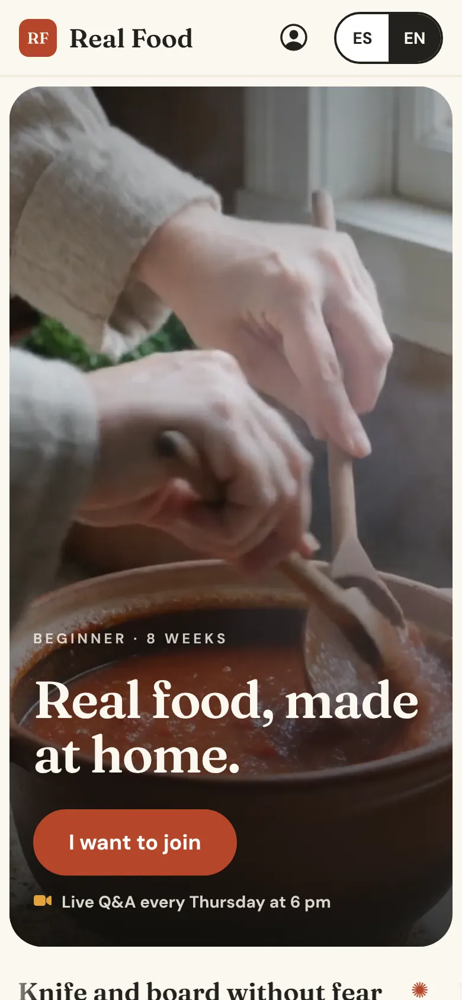

Every page is built for phones first, since most visitors come from Instagram.

## Step 2 — Courses

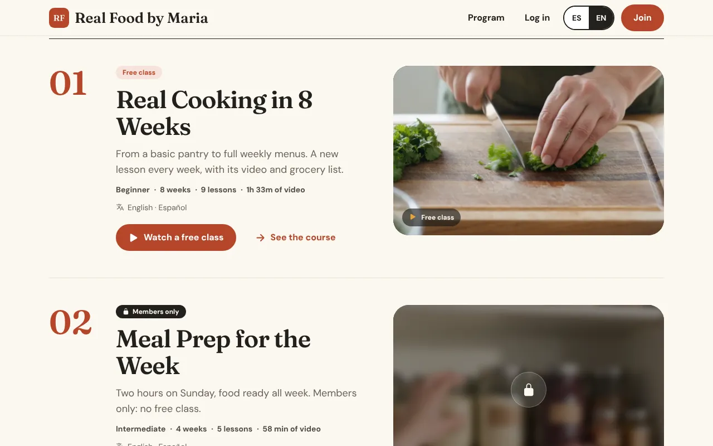

- **What it shows:** all your courses, each with a cover photo, how many lessons it has, the total time, and the languages it's in.
- **What visitors can do:** open a course, or watch its free class right from the list.
- Courses for members only show a lock. Free classes are marked free.

## Step 3 — Course page

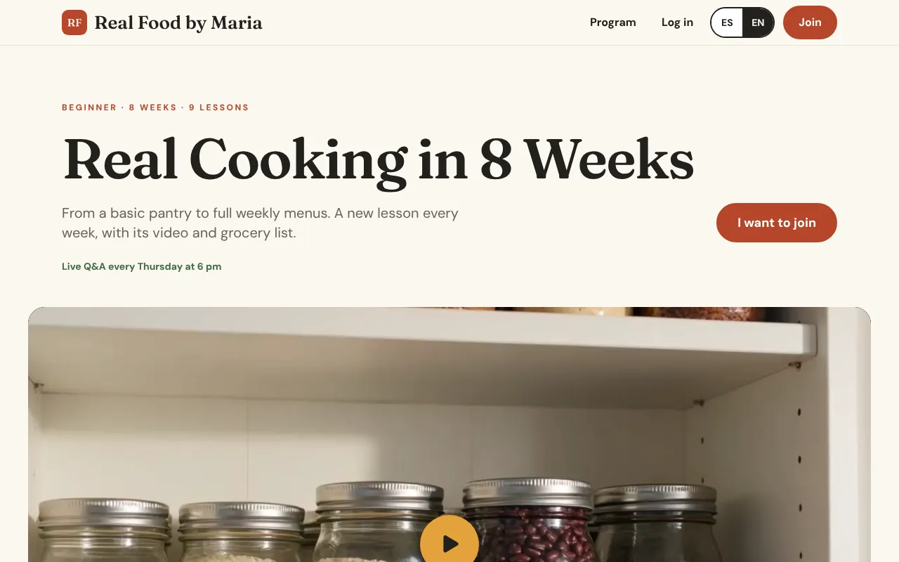

- **What it shows:** the course description, what students will learn, and the full list of lessons.
- **What visitors can do:** watch the free lessons, and see the titles of the members-only lessons so they know what they'd get.

## Step 4 — Locked lessons

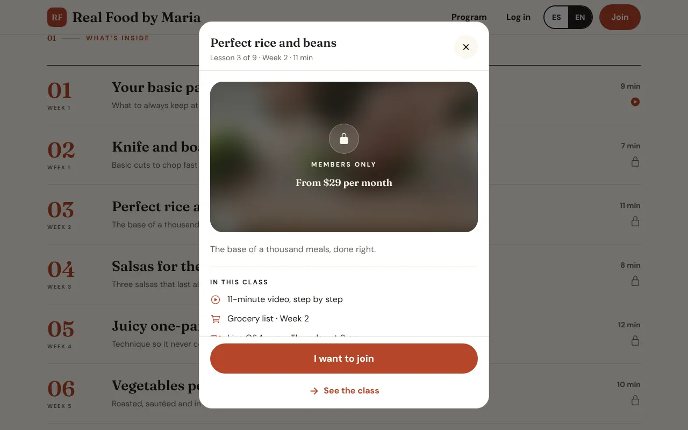

When someone who isn't a member taps a locked lesson, a short panel explains what membership includes and offers the plans. They never hit a dead end.

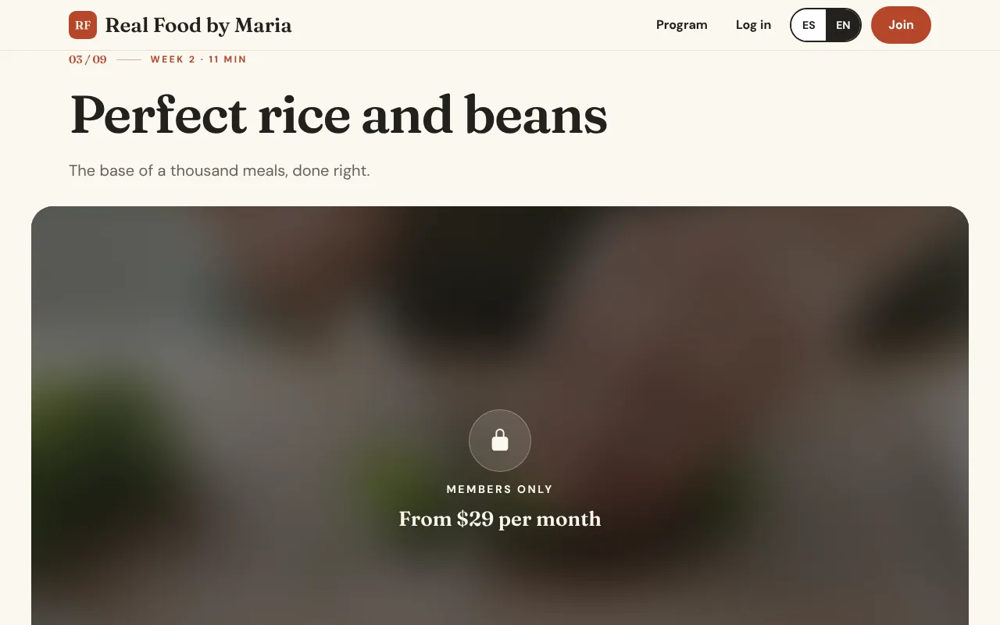

If someone opens a locked lesson from a shared link, they see its title and description with a button to join. The video and downloads stay private.

## Step 5 — Free class and the video player

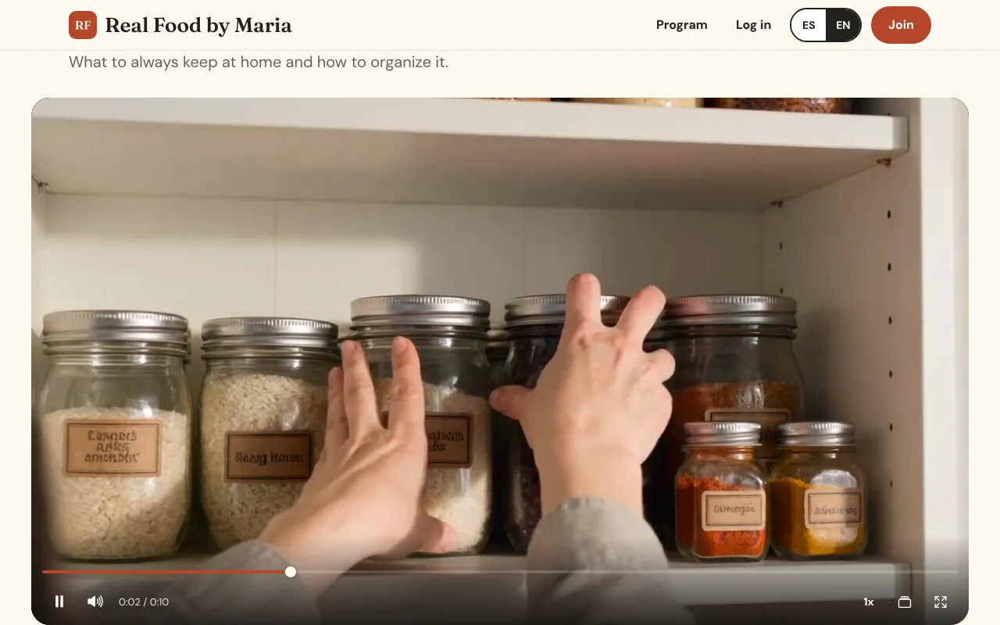

- **What it shows:** your own private video player, with no download button.
- **What viewers can do:** pause, skip, go full screen, and change the speed. The video picks up where they left off, and their speed choice is remembered.
- Videos are stored privately. Each play uses a link that expires, so videos can't be copied and shared around.

## Step 6 — Join

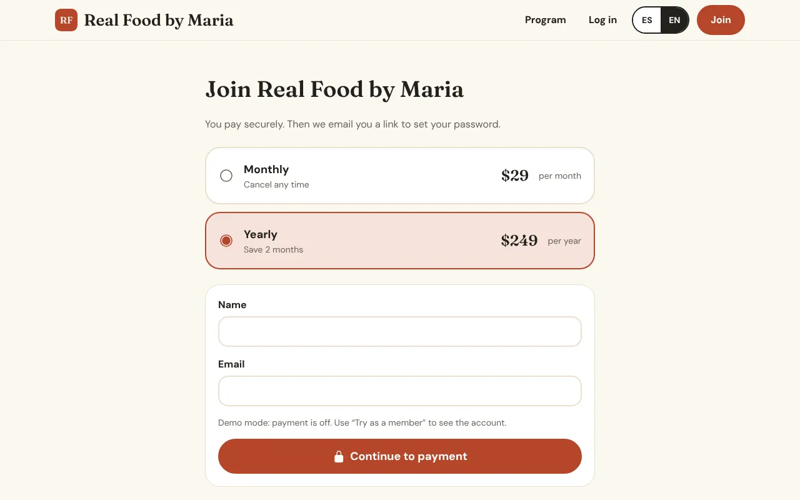

- **What it shows:** the plans side by side and what each includes.
- **What visitors can do:** pick a plan and pay with card, Apple Pay or Google Pay through Stripe. Their account is created right after paying.
- Payments go straight to your Stripe account. Members can cancel or change their card on their own.

> Apple and Google take a cut of sales made inside apps. To avoid that, people join on the website, then sign in to the app with the same account.

## Step 7 — Member home

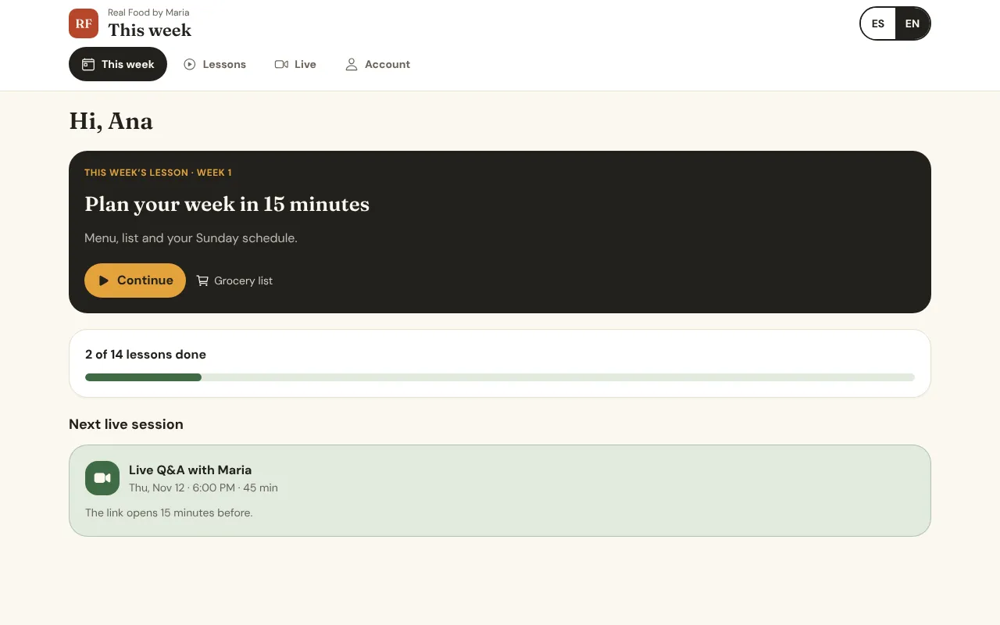

What members see after signing in.

- **What it shows:** the lesson to continue, this week's new lesson, and the next live class.
- **What members can do:** jump back into their lesson in one tap.

## Step 8 — Lessons

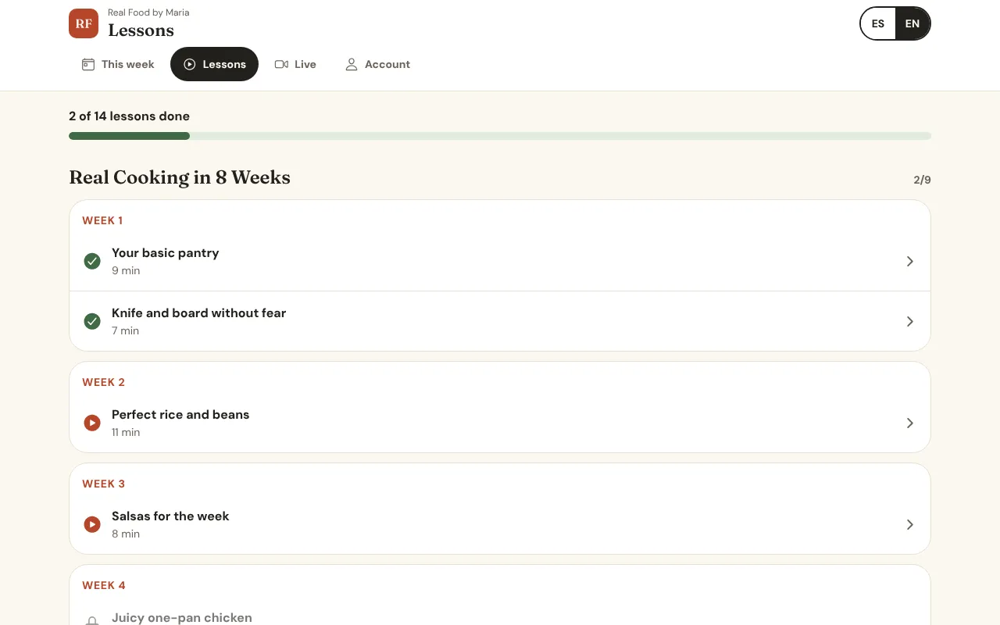

- **What it shows:** every lesson they can watch, newest first, with the ones they've finished marked.
- Lessons unlock week by week, counted from the day each member joins, so new members start at week 1.

## Step 9 — Lesson

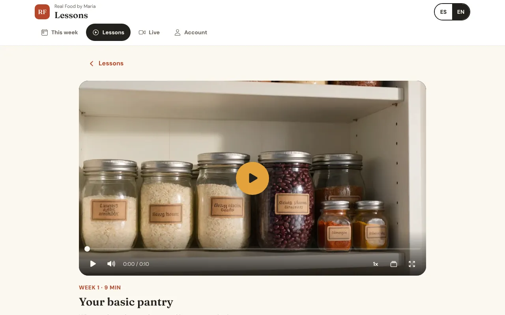

- **What it shows:** the video, the written notes, and the downloads (recipe cards, shopping lists, PDFs).
- **What members can do:** watch, download the files, and mark the lesson as done.

## Step 10 — Live classes

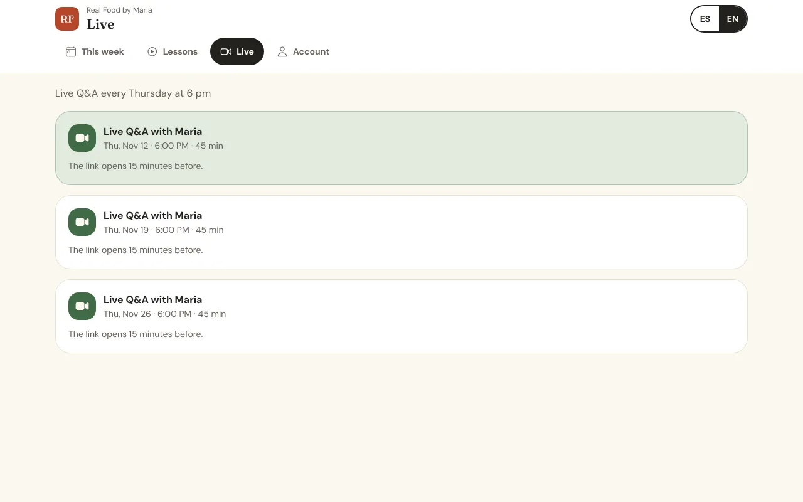

- **What it shows:** the upcoming live classes with the date, time and topic.
- **What members can do:** tap to join on Zoom or Google Meet when it starts. They also get an email reminder the day of the class.

## Step 11 — Account

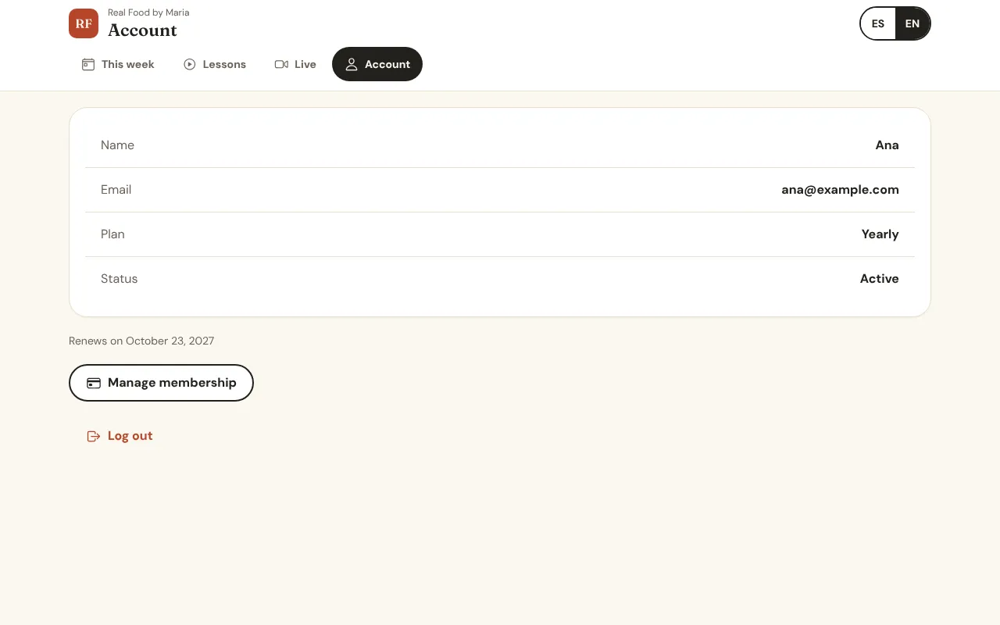

- **What it shows:** their plan, when it renews, and their language.
- **What members can do:** manage payment (change card, cancel) through Stripe's secure page, and sign out.

## Step 12 — Link page (your Instagram bio link)

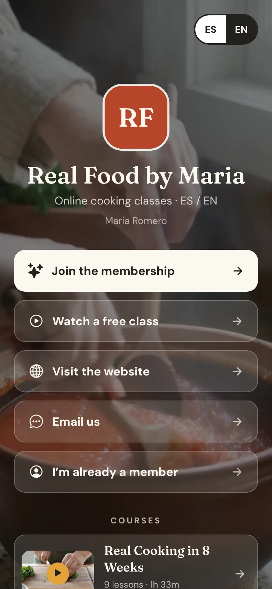

One link for your Instagram bio, with your photo and big buttons: Join, Free class, Website, Email, and course covers. It replaces Linktree and sends people straight into your platform.

---

## Summary

| Page | Visitors can | Members can |
| --- | --- | --- |
| Home | Read, compare plans, switch language | Same |
| Courses / Course page | Browse, watch free lessons | Watch everything included in their plan |
| Video player | Free classes only | All lessons; resume and speed are remembered |
| Join | Pay and create an account | Change plan |
| Member home, Lessons, Lesson | — | Watch, download, track progress |
| Live classes | — | Join on Zoom or Meet, get reminders |
| Account | — | Manage payment, cancel, change language |
| Link page | Everything above, one tap away | Same |

<!-- lang:es -->
# Tu plataforma, página por página

*Real Food by Maria · Actualizado el 9 de noviembre de 2026*

Esta guía recorre cada página de la plataforma: qué muestra y qué pueden hacer tus visitantes y tus miembros. Las capturas son del demo en courses--maria.expo.app. Los colores, fotos y textos cambian cuando la construyamos con tu contenido real.

## Cómo usar esta guía

| Parte | Quién la ve | Páginas |
| --- | --- | --- |
| Páginas públicas | Cualquiera, antes de pagar | Inicio, Cursos, Página del curso, Clase gratis, Unirse, Página de enlaces |
| Área de miembros | Miembros que pagan, después de entrar | Inicio de miembro, Lecciones, Lección, Clases en vivo, Cuenta |
| Tu panel | Solo tú | Ver la guía **Tu panel** |

> La misma plataforma funciona como sitio web y como apps para iPhone y Android. Los miembros entran una vez y su progreso los sigue en todos sus dispositivos.

---

## Paso 1 — Página de inicio

La primera página que la gente ve desde Instagram, Google o un enlace compartido.

- **Qué muestra:** tu foto o video, tu nombre, una frase sobre lo que enseñas y un botón para unirse.
- **Qué pueden hacer los visitantes:** leer sobre el programa, ver cómo es una semana, comparar planes y leer las preguntas frecuentes.
- **Idioma:** un botón arriba cambia todo entre inglés y español. El sitio recuerda la elección.

**La sección del programa** explica cómo funciona: lecciones nuevas cada semana, recetas para descargar y clases en vivo para hacer preguntas.

**La sección de planes** muestra cada membresía con su precio y lo que incluye, para que la gente elija antes de inscribirse.

**Síguenos** enlaza a tu Instagram, TikTok, YouTube y Facebook, y a tu página de enlaces.

Cada página está hecha primero para el teléfono, porque la mayoría llega desde Instagram.

## Paso 2 — Cursos

- **Qué muestra:** todos tus cursos, cada uno con foto de portada, número de lecciones, duración total e idiomas.
- **Qué pueden hacer los visitantes:** abrir un curso o ver su clase gratis directo desde la lista.
- Los cursos solo para miembros muestran un candado. Las clases gratis dicen gratis.

## Paso 3 — Página del curso

- **Qué muestra:** la descripción del curso, lo que van a aprender y la lista completa de lecciones.
- **Qué pueden hacer los visitantes:** ver las lecciones gratis y ver los títulos de las lecciones para miembros, para saber qué recibirían.

## Paso 4 — Lecciones bloqueadas

Cuando alguien que no es miembro toca una lección bloqueada, un panel corto explica qué incluye la membresía y muestra los planes. Nunca se quedan sin salida.

Si alguien abre una lección bloqueada desde un enlace compartido, ve el título y la descripción con un botón para unirse. El video y las descargas siguen privados.

## Paso 5 — Clase gratis y el reproductor

- **Qué muestra:** tu propio reproductor de video privado, sin botón de descarga.
- **Qué pueden hacer:** pausar, adelantar, pantalla completa y cambiar la velocidad. El video sigue donde se quedaron y recuerda la velocidad.
- Los videos se guardan en privado. Cada reproducción usa un enlace que caduca, así que no se pueden copiar ni compartir.

## Paso 6 — Unirse

- **Qué muestra:** los planes lado a lado y lo que incluye cada uno.
- **Qué pueden hacer los visitantes:** elegir un plan y pagar con tarjeta, Apple Pay o Google Pay por Stripe. Su cuenta se crea al pagar.
- Los pagos llegan directo a tu cuenta de Stripe. Los miembros pueden cancelar o cambiar su tarjeta por su cuenta.

> Apple y Google cobran una comisión por ventas dentro de las apps. Para evitarla, la gente se une en el sitio web y luego entra a la app con la misma cuenta.

## Paso 7 — Inicio de miembro

Lo que ven los miembros al entrar.

- **Qué muestra:** la lección para continuar, la lección nueva de la semana y la próxima clase en vivo.
- **Qué pueden hacer:** volver a su lección con un toque.

## Paso 8 — Lecciones

- **Qué muestra:** todas las lecciones que pueden ver, las más nuevas primero, con las terminadas marcadas.
- Las lecciones se desbloquean semana por semana, contando desde el día que cada miembro se une, así que los nuevos empiezan en la semana 1.

## Paso 9 — Lección

- **Qué muestra:** el video, las notas escritas y las descargas (tarjetas de receta, listas del súper, PDFs).
- **Qué pueden hacer:** ver, descargar los archivos y marcar la lección como terminada.

## Paso 10 — Clases en vivo

- **Qué muestra:** las próximas clases en vivo con fecha, hora y tema.
- **Qué pueden hacer:** tocar para entrar por Zoom o Google Meet cuando empieza. También reciben un correo recordatorio el día de la clase.

## Paso 11 — Cuenta

- **Qué muestra:** su plan, cuándo se renueva y su idioma.
- **Qué pueden hacer:** administrar su pago (cambiar tarjeta, cancelar) en la página segura de Stripe y cerrar sesión.

## Paso 12 — Página de enlaces (el link de tu Instagram)

Un solo enlace para tu bio de Instagram, con tu foto y botones grandes: Unirse, Clase gratis, Sitio web, Correo y las portadas de tus cursos. Reemplaza a Linktree y lleva a la gente directo a tu plataforma.

---

## Resumen

| Página | Visitantes pueden | Miembros pueden |
| --- | --- | --- |
| Inicio | Leer, comparar planes, cambiar idioma | Lo mismo |
| Cursos / Página del curso | Explorar, ver lecciones gratis | Ver todo lo que incluye su plan |
| Reproductor | Solo clases gratis | Todas las lecciones; recuerda dónde iban y la velocidad |
| Unirse | Pagar y crear cuenta | Cambiar de plan |
| Inicio de miembro, Lecciones, Lección | — | Ver, descargar, llevar su progreso |
| Clases en vivo | — | Entrar por Zoom o Meet, recibir recordatorios |
| Cuenta | — | Administrar pago, cancelar, cambiar idioma |
| Página de enlaces | Todo lo anterior, a un toque | Lo mismo |
